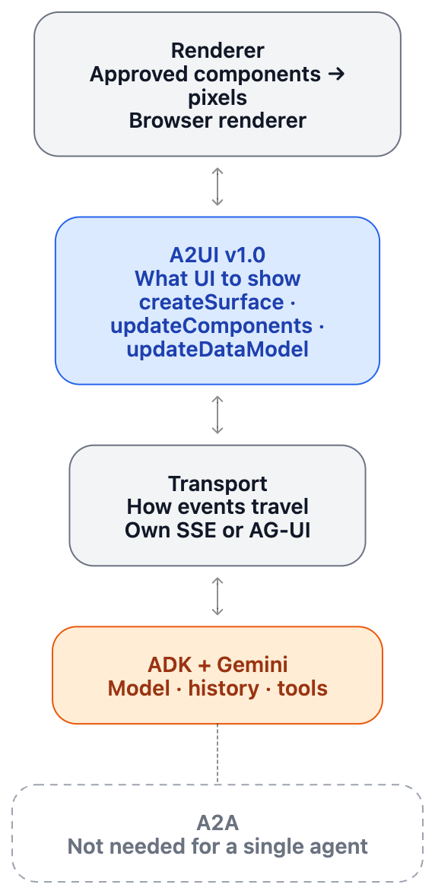
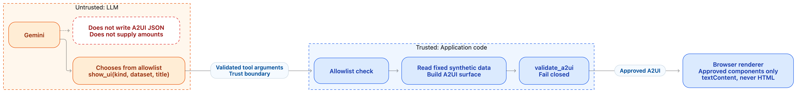
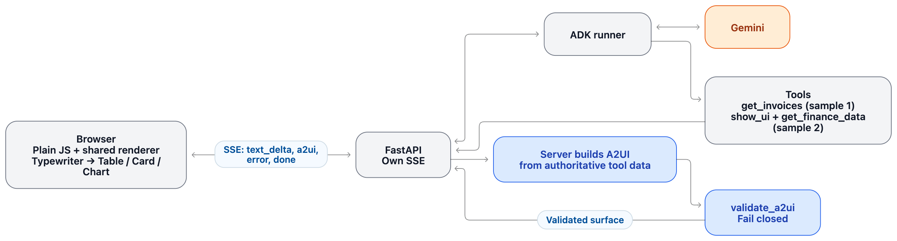
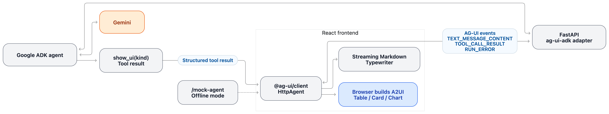
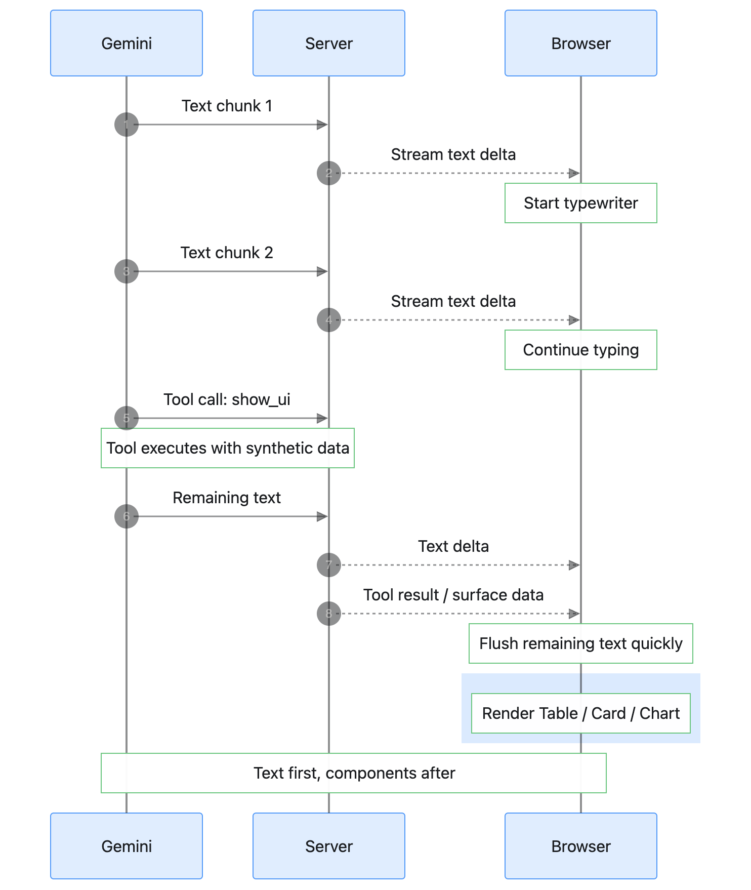
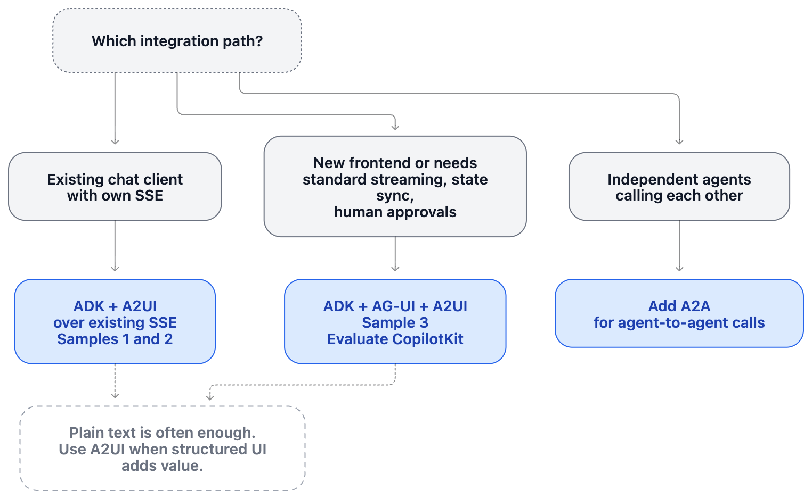

# a2ui_adk

Three small demos of Google ADK agents that answer with Markdown text plus A2UI v1.0 UI components. All data is synthetic. Run one at a time. See [Architecture and design thinking](#architecture-and-design-thinking) for why the demos are built the way they are.

| Sample | Shows | Transport |
|---|---|---|
| [1_table](samples/1_table) | A2UI v1.0 with a single `Table` component | own SSE, plain HTML/JS |
| [2_components](samples/2_components) | Agent picks `Table`, `Card` or `Chart` | own SSE, plain HTML/JS |
| [3_agui_react](samples/3_agui_react) | Same components over AG-UI via `ag_ui_adk` | AG-UI, React frontend |

## Setup

```bash
uv sync   # one shared environment (pyproject.toml) for all three samples
cp .env.example .env   # DEMO_MODE=adk (default) needs GOOGLE_API_KEY; set DEMO_MODE=mock to run offline
```

## Run

Samples 1 and 2 (open http://localhost:8000):
```bash
uv run uvicorn app.server:app --reload --app-dir samples/1_table
uv run uvicorn app.server:app --reload --app-dir samples/2_components
```

Sample 3 (backend on :8000, frontend on http://127.0.0.1:5173):
```bash
uv run uvicorn backend.app:app --reload --app-dir samples/3_agui_react
npm --prefix samples/3_agui_react/frontend install
npm --prefix samples/3_agui_react/frontend run dev   # in a second terminal
```

## Tests

```bash
for s in samples/*/; do (cd "$s" && uv run python -m pytest -q tests); done
```

The sample READMEs describe each demo in more detail; run their commands from inside the sample folder.

## Architecture and design thinking

### The layers

One accounting-assistant agent, four separate concerns. Keeping them apart is the main idea of the repo:

| Layer | Question it answers | Used here |
|---|---|---|
| **ADK** | Model, conversation history, tools | Python Google ADK, Gemini |
| **A2UI** | *What* UI should be shown, as declarative messages (`createSurface`, `updateComponents`, `updateDataModel`) | A2UI v1.0 envelopes with a small custom catalog |
| **Transport** | How agent and browser exchange events | Own SSE (samples 1-2), AG-UI (sample 3) |
| **Renderer** | Turning approved components into pixels | Small hand-written renderer in the browser |

A2UI is a presentation format on top of an ordinary agent. It needs no separate UI agent, no A2A and no workflow engine. A2A is for independent agents talking to each other and is unnecessary for a single agent. AG-UI is the optional transport layer for streaming events between agent and frontend; A2UI also works over plain SSE.



### Core design decision: the model chooses, the code builds

In all three samples the LLM **never writes A2UI JSON and never supplies the data**. It only calls a tool:

- Sample 1: the model calls `get_invoices`; the server turns the *tool response* into a table surface.
- Sample 2: the model calls `show_ui(kind, dataset, title)` and `get_finance_data`; kind and dataset come from allowlists, and the server builds the surface from fixed synthetic data.
- Sample 3: the model calls `show_ui(kind)`; the browser builds the surface from its own synthetic data.

Why: an accounting assistant must not invent numbers, and model-written UI is untrusted input. Selecting from an allowlist keeps amounts out of the model's hands, makes output validity a deterministic property of our code instead of the model's behaviour, and makes the UI easy to test. The price is flexibility: the model can only choose among components we ship, and it cannot compose new layouts.



Everything that does cross a trust boundary is checked. The server-side `validate_a2ui` fails closed on envelope shape, catalog id, component names, unique ids, `root`, children, per-component properties, data bindings and prototype-pollution paths. The browser renderer repeats the envelope and catalog checks, only renders approved components, writes everything with `textContent` (never HTML), and discards a surface that fails to render.

### How the three demos differ

```
1_table       Browser ⇄ own SSE ⇄ FastAPI ⇄ ADK runner ⇄ Gemini
              tool result (invoices) → server builds A2UI Table

2_components  Browser ⇄ own SSE ⇄ FastAPI ⇄ ADK runner ⇄ Gemini
              tool call show_ui(kind, dataset, title) → server builds Table | Card | Chart

3_agui_react  React ⇄ AG-UI events ⇄ FastAPI + ag-ui-adk ⇄ ADK ⇄ Gemini
              tool result show_ui(kind) → browser builds Table | Card | Chart
```





| | 1_table | 2_components | 3_agui_react |
|---|---|---|---|
| Point of the demo | Smallest possible A2UI round trip | Agent decides *which* component | Same idea over a standard protocol |
| Who builds the surface | Server | Server | Browser |
| Transport | Own SSE events (`text_delta`, `a2ui`, `error`, `done`) | Same | AG-UI (`TEXT_MESSAGE_CONTENT`, `TOOL_CALL_RESULT`, `RUN_ERROR`, …) |
| Frontend | Plain JS + shared renderer | Plain JS + shared renderer | React + `@ag-ui/client` |
| Catalog | `accounting/v1.json` (`Column`, `Text`, `Table`) | `accounting/v2.json` (+ `Card`, `Chart`) | `accounting/v3.json` (`Table`, `Card`, `Chart`) |

The catalogs are genuinely different contracts, so they have different ids. Samples 1 and 2 share one renderer ([samples/shared/a2ui-renderer.js](samples/shared/a2ui-renderer.js)); each sample passes in its catalog id and extra components. Sample 3 renders with React components.

### Streaming behaviour

Text streams first and components follow. The server forwards every ADK text chunk as it arrives (no artificial delay with Gemini; the fixed per-word pause exists only in mock mode). The browser reveals text through a small typewriter so bursty chunks still look like typing, and it flushes the rest quickly once the stream ends. Components render after the text has finished, so a table never appears above a half-written sentence. Surfaces are built from the authoritative tool *result*, not from partially streamed model output.



### Relation to Google's recommended path

Google's current guidance is ADK + AG-UI + A2UI + CopilotKit for generative UI, and the official A2UI agent guide has the *model* generate A2UI, guided by an SDK-provided instruction and catalog, with the SDK parsing and validating the output. This repo deliberately takes the more conservative route above instead. Specifically:

- It does **not** use the official A2UI Python SDK, its instruction helpers or the official renderer. The envelopes follow A2UI v1.0 (a Candidate release), but the catalog and renderer are custom and narrow. Treat them as a reference for the idea, not a compliant runtime.
- It does **not** use CopilotKit. Sample 3 uses AG-UI's reference client directly, to test whether AG-UI plus a standalone A2UI renderer is enough without CopilotKit.
- It uses a **fixed** catalog and **synthetic** data, so it demonstrates the architecture without any accounting backend.

### Choosing a path (summary of the thinking so far)

| Situation | Suggested path |
|---|---|
| Existing chat client with its own SSE | ADK + A2UI over your existing SSE (samples 1-2). Add only A2UI payloads; do not adopt a new protocol just to get A2UI |
| New frontend, or you want standard streaming, state sync and human-in-the-loop approvals | ADK + AG-UI + A2UI (sample 3), and evaluate CopilotKit |
| Several independent agents that must call each other | Add A2A. Not needed for one agent |



Practical advice that applies to any of them:

1. Do not push every answer through A2UI. Plain text is often right for an accounting assistant; invoice lists, financial overviews and approval forms benefit from structured UI.
2. Start with a small catalog (for example `Text`, `Card`, `Table`, `Button`) and grow it deliberately.
3. Pin the A2UI version and the catalog id on both backend and frontend.
4. Parse and validate A2UI output in the API layer, fall back to text on invalid output, and do not log generated UI that contains personal data.
5. Handle button actions as structured user actions sent back to the agent.
6. Evaluate both the correctness of the data and the validity of the generated UI.

### Known limits and next steps

- ADK sessions are in-memory with a fixed `demo` user. Production needs authenticated user ids, durable sessions, access control and redaction.
- The A2UI surfaces are not model-generated and not transmitted as native A2UI events over AG-UI. A natural next experiment is letting the model produce A2UI through the official SDK in a restricted catalog, validating it server-side, and comparing error rates against the allowlist approach used here.
- Sample 3's frontend pulls in `zod@3` via `@ag-ui/client`, which has an open `npm audit` advisory with no compatible fix yet; this is low risk for a local demo.
- Real incremental A2UI streaming (fragments while the model is still generating) is not implemented. Complete tool results are rendered once the text has finished.
